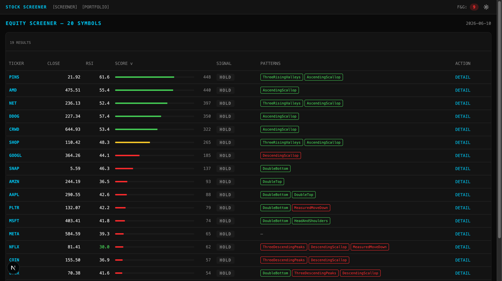
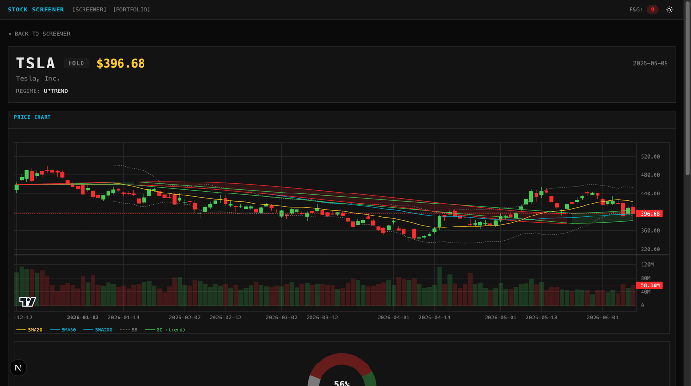

# Stock Checker

Stock Checker screens US equities and evaluates strategies with a shared signal
engine, web dashboards, local MCP reports, a CLI, and WhatsApp notifications.

| Workspace | Purpose |
|---|---|
| `packages/core` | Signals, backtests, persistence, and CLI |
| `packages/automation` | TypeScript service tooling and WhatsApp SDK regressions |
| `apps/api` | Fastify API — port 5101 |
| `apps/web` | Next.js dashboard — port 5100 |
| `apps/mcp` | Local stdio MCP reports and screening |
| `packages/finance` | Python 3.14 finance tools, Ruff, and Pyrefly |

| Screener | Ticker detail |
|---|---|
|  |  |

## Quick start

Install [mise](https://mise.jdx.dev), then run from the repository:

```bash
mise install        # Node 26, Bun, Python 3.14, and uv
mise run install    # dependencies and Git hooks
mise run dev        # API + web
```

Open `http://localhost:5100`. See [mise.toml](mise.toml) or `mise tasks` for commands.
The local MCP works without web servers; browser dashboards require `dev`.

## Web dashboard

| Menu or page | Route | Features |
|---|---|---|
| SCREENER | `/` | Signals, scores, and sector heatmap for the selected 20 symbols |
| MARKET SCREEN | `/market-screen` | Saved Finviz jobs, progress, results, pause/resume, and paper performance |
| PORTFOLIO | `/portfolio` | Portfolio tickers and current analysis |
| WATCHLIST | `/watchlist` | Tracked tickers and current analysis |
| ALERTS | `/alerts` | Browser alert rules and notification settings |
| Ticker detail | `/:ticker` | Charts, signal, fundamentals, earnings, news, and events |
| Backtest | `/:ticker/backtest` | Historical strategy evaluation |

Create Finviz jobs through the [MCP flow](#finviz-candidate-screening).
MARKET SCREEN reads saved jobs. Resume continues pending candidates;
pause lets in-flight requests finish.
Browser alerts run while the app or PWA is open; they stop when it closes.

## CLI

```bash
mise run predict -- --ticker=TSLA,PLTR --sort=asc
mise run predict -- --ticker=OII --format=json
mise run backtest -- --cost-bps=20
mise run backtest -- --research --quick
```

Default predictions append monthly CSV rows under `packages/core/public/`;
`--format=json` exports JSON instead. Other flags include `--sort=asc|desc`,
`--fundamentals`, `--news`, `--earnings`, `--dividends`, and `--options`.
Use `mise run predict -- --help` for the full list.
For Slack BUY/SELL summaries, set `SLACK_WEBHOOK_URL` or pass `--slack-webhook`.

CLI, web, MCP, screening, and backtests share the leader-pullback strategy and
the complete configuration in `data/config/optimized_weights.json` (v3).
Without a compatible file, all use `DEFAULT_QUALITY_PIPELINE_CONFIG`; legacy
partial weight files are ignored. No command rewrites that file: the former
`optimize`/`learn` loop and the weekly optimization workflow were removed
because they overwrote the validated configuration with a winner fitted on a
single ticker. `backtest` measures the active configuration; `--research`
replays the retired exploratory variants without saving anything.
See [trading principles](docs/TRADING_PRINCIPLES.md) and the
[measured win rates](docs/validation/leader-pullback-2026-10-06.md).

## Local MCP

Reopen Codex or Claude Code in this repository after installation.
`stock_checker` is registered in [.codex/config.toml](.codex/config.toml) and
[.mcp.json](.mcp.json), using `mise run mcp` over stdio. Keys and recipient settings
come from the environment or private MCP configuration; reconnect after changes.
The separate Serena and Aside entries require their own installed CLIs.

| Tools | Use |
|---|---|
| `analyze_stock` | Signal reasons, historical rates, ATR references, PER/PSR peer comparisons, and analyst targets |
| `show_stock_dashboard`, `open_stock_dashboard` | Inline MCP Apps dashboard or existing web page in the browser |
| `screen_stocks` | Final SC decisions for a selected list of up to 50 tickers |
| `prepare_finviz_screen`, `create_market_screen` | Prepare collection filters and save a durable candidate job |
| `get_market_screen`, `control_market_screen` | Read results or pause/resume a saved job |
| `get_market_screen_performance`, `refresh_market_screen_performance` | Read cached paper outcomes or explicitly fetch later prices |

Example `analyze_stock` input:

```json
{"ticker":"OII","lookbackDays":730}
```

Example `screen_stocks` input:

```json
{"tickers":["OII","NVDA","TSLA"],"decision":"BUY","limit":20}
```

An empty screen input uses the selected 20 symbols. Decisions are `BUY` (default),
`SELL`, `HOLD`, or `ALL`; a high score alone does not qualify BUY. Screen lookback
defaults to 730 days; ticker reports default to 2920. Both accept 730–3650 days;
use the same window when comparing them. Selected scans retain completed results
after their 45-second budget expires.
Inline dashboards require an MCP Apps-capable client; browser dashboards require
the web server and do not start it automatically.

### Finviz candidate screening

The market flow has two steps:

1. Call `prepare_finviz_screen`, then collect its ticker rows through an authorized
   browser MCP such as Aside or a supplied export. Preparation does not fetch pages.
2. Call `create_market_screen` with those tickers and their Finviz provenance.
   SC evaluates the saved candidates with its existing signal engine.

BUY preparation defaults to stocks below SMA50. Market-cap, average-volume,
and price cuts are optional; `belowSma50: false` broadens collection. Finviz
covers US exchanges, and its intraday filters can differ from SC's completed bars.
A Finviz match is a candidate, not a final SC BUY.

Preserve the source URL, ordered filters, filtered total, capture time, and
`complete`/`partial` status. Complete collection requires the unique count to
equal the declared total; missing or blocked pages remain partial.
Public browser collection needs no Finviz key.

Reports show the collected candidate count and evaluated count separately. A candidate
limit is not an analysis failure. Unavailable results retain their cause, including
missing history, invalid prices or average daily price ranges, or infeasible risk references; risk rejections
do not pause the job as provider failures.

Jobs accept up to 15,000 input rows and live in ignored `data/market-scans/`.
Creation starts work by default; `autoStart: false` saves a paused manifest.
Read with `get_market_screen`; use `control_market_screen` with `action: "pause"`
or `"resume"`. Keep the runner open and explicitly resume after interruption;
completed symbols are retained. Collection coverage and analysis completion
are reported separately.

Matched BUY paper outcomes use the next session open to the fifth session close
(including the entry session), with 10 bps round-trip cost. Win rates use completed
wins/sample counts; pending and unavailable records remain separate, and zero
completed samples means no rate. Refresh performance explicitly to fetch later
prices; reads use saved data. These are simulated observations, not brokerage fills.
Scores are not win probabilities. No validated out-of-sample win rate is published
for the current implementation.

## WhatsApp notifications

Link a WhatsApp Web account through the local gateway; no Meta Cloud API key,
template, or message-fee setup is needed. Set `WHATSAPP_TO` to the recipient's full
E.164 number, including `+` and country code, in ignored `mise.local.toml`:

```toml
[env]
WHATSAPP_TO = "YOUR_E164_NUMBER"
```

On macOS, install the user service with initial pairing enabled:

```bash
mise run whatsapp:service:install -- --link
```

Open `http://127.0.0.1:5102/` and scan the QR from the phone's
**Settings → Linked devices → Link a device**. Then switch to normal mode:

```bash
mise run whatsapp:service:install
mise run whatsapp:service:status
```

Use `whatsapp:service:restart` for an expired QR; `start`, `stop`, and `uninstall`
control the service. The computer must be logged in, awake, and online. The service
loads mise settings; temporary shell exports do not persist into it.
For foreground use, run `whatsapp:link` and leave it running, or stop it and run
`whatsapp:gateway`. Linked sessions remain in ignored `data/whatsapp/`.

CLI BUY/SELL batches and market-screen completion summaries send after saving
results. MCP `screen_stocks` sends only with `notifyWhatsApp: true` (default false).
Every message opens with the completed US session date. Up to three detailed
BUY tickers carry a `매매 계획` block (next-session open entry and fifth-session
close exit as US dates with Australia/Sydney times from the shared NYSE calendar,
a position-size hint, and the in-sample validated expectation), the original
decision and reasons, per-ticker BUY history (collapsed to counts and dates below
ten samples), analyst targets, and ATR stop/target levels labelled as references
outside the validated rule. Zero-match mornings send a short heartbeat instead.
Set `STOCK_CHECKER_MAX_POSITIONS` (default 5) and optionally
`STOCK_CHECKER_CAPITAL` to shape the size hint. Failures preserve results.
Restart API/MCP after changing the recipient; relinking is unnecessary.
Unconfigured recipients and GitHub-hosted jobs send nothing.

Before each send the client probes the gateway's `/status`; while the gateway is
unreachable or the session is not `connected`, nothing has been sent, so it waits
and re-probes at about 0/60/180/600 s before giving up. Once a request is posted,
ambiguous outcomes (timeouts, 502/504) are never retried, so a message cannot be
duplicated. When the session is not connected or a send is not accepted, a macOS
Notification Center alert is raised (set `STOCK_CHECKER_DESKTOP_ALERTS=0` to
disable). The gateway only sends to the `WHATSAPP_TO` number (403 otherwise) and
refuses more than `WHATSAPP_DAILY_SEND_CAP` sends per local date (default 50,
429 `daily-send-cap`). `GET /status` reports the session state, how long it has
held, today's send count, and the last send result.

**Account risk.** The gateway links a personal WhatsApp account through an
unofficial WhatsApp Web client (Baileys). WhatsApp's terms do not permit
automated clients; accounts using them can be rate limited or banned without
notice, and the only recovery is a manual re-link or a new number. Use a
dedicated number if possible, keep the recipient pinned and the daily cap low,
and never expose the gateway beyond loopback. The official WhatsApp Business
Cloud API is the supported alternative when a template-based, fee-bearing
integration is acceptable.

For daily reports, run `mise run daily-report:service:install` on macOS.
The service starts once each day at 09:00 Australia/Sydney, including DST;
it can start until 09:14 if the computer wakes late, and a late catch-up run is
allowed afterwards until 90 minutes before the next NYSE open (still once per
Sydney date, labelled `(지연)`). Keep the computer logged in, awake, and online.
By default the report scans the configured validated universe (the ticker list
the leader-pullback edge was measured on; no browser needed) with the shared
engine for up to 20 minutes, which the `--dry-run` estimate keeps within budget.
Each run records the latest completed NYSE session; a later Sydney date whose
session was already delivered (Sunday, Monday, post-holiday) is skipped with
`no-new-session` instead of resending the same result, and the session date is
shown in the report title. Set `DAILY_REPORT_SOURCE=finviz` before installing to
opt into the Finviz discovery lane instead: stocks below SMA50 ordered by
descending volume, up to 200 candidates in 60 seconds, labelled as an
unvalidated universe in the saved job; a Finviz or Aside failure falls back to
the configured universe. Saved jobs record collection coverage (`capped` by the
candidate limit versus a `partial` failure) separately from analysis status and
appear in MARKET SCREEN. Check with `mise run daily-report:service:status` or
`mise run daily-report -- --status`. `--dry-run` checks readiness without
scanning or sending. Set `DAILY_REPORT_MAX_CANDIDATES`, `DAILY_REPORT_MAX_PAGES`,
or `ASIDE_BIN` privately for the Finviz lane. `mise run market-scans:prune --
--days=30` archives older scans while keeping BUY matches and paper ledgers.

## Optional configuration

Yahoo data needs no API key. Optional environment or private client settings:

| Variable | Purpose |
|---|---|
| `TIINGO_API_KEY` | Daily-OHLCV fallback when Yahoo fails |
| `FMP_API_KEY` | Fallback for recent individual analyst target updates |
| `WHATSAPP_AUTH_DIR`, `WHATSAPP_GATEWAY_URL`, `WHATSAPP_GATEWAY_TOKEN` | Override the local session directory, loopback gateway, or token |
| `WHATSAPP_DAILY_SEND_CAP`, `STOCK_CHECKER_DESKTOP_ALERTS` | Gateway sends per local date (default 50); `0` disables macOS failure alerts |
| `STOCK_CHECKER_MAX_POSITIONS`, `STOCK_CHECKER_CAPITAL` | Position-size hint in BUY messages (default 1/5 of capital, 5 concurrent) |
| `STOCK_CHECKER_DASHBOARD_URL` | MCP browser links; default `http://localhost:5100` |

See [the API environment example](apps/api/.env.example) for the configuration.

## Development and releases

```bash
mise run lint             # Biome + Ruff lint/format checks
mise run typecheck        # TypeScript no-emit + Python Pyrefly
mise run test             # offline workspace, finance, and automation regressions
mise run deps:outdated
mise run deps:update
```

Add `:core`, `:api`, `:web`, or `:mcp` to `test` / `typecheck` for scoped checks.
mise imports Bun workspace scripts using its experimental Node task inference;
`mise run //apps/web:typecheck` runs the package script directly. Automation
uses `.mts` and `tsx`; `typecheck:automation` is included in the same quality gate.
Python uses `packages/finance/uv.lock`; `finance:run` executes scripts, and
`finance:deps:outdated` / `finance:deps:update` maintain the lock.
[Quality](.github/workflows/quality.yml) includes application and Python checks;
[daily data](.github/workflows/daily-data.yml) commits CSV predictions on US
weekdays, tagging each row with `StrategyId` and `ConfigSha256`.

Main pushes run [Release Please](.github/workflows/release.yml): synchronize
versions and `bun.lock`, validate the release PR, then merge and create the release.
Use Conventional Commits: `feat` bumps minor, `fix` and configured maintenance
types bump patch, and breaking changes bump major. Failed checks leave the PR open.
Nightly `chore(data)` CSV commits touch only `packages/core/public/`, which is
excluded from release calculation, so they never cut a release on their own.
